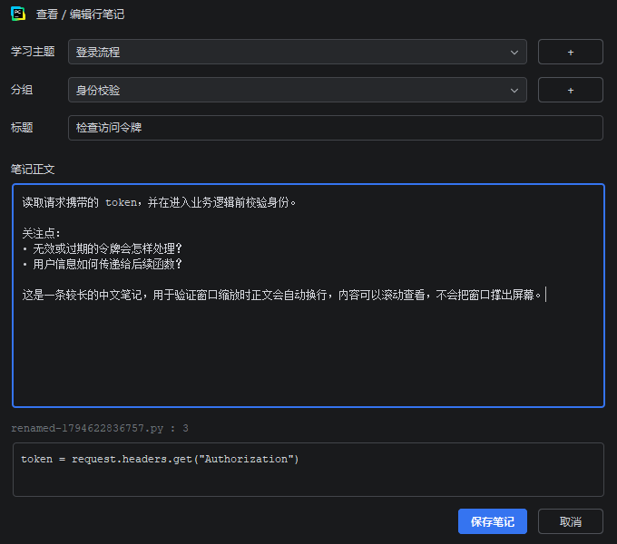
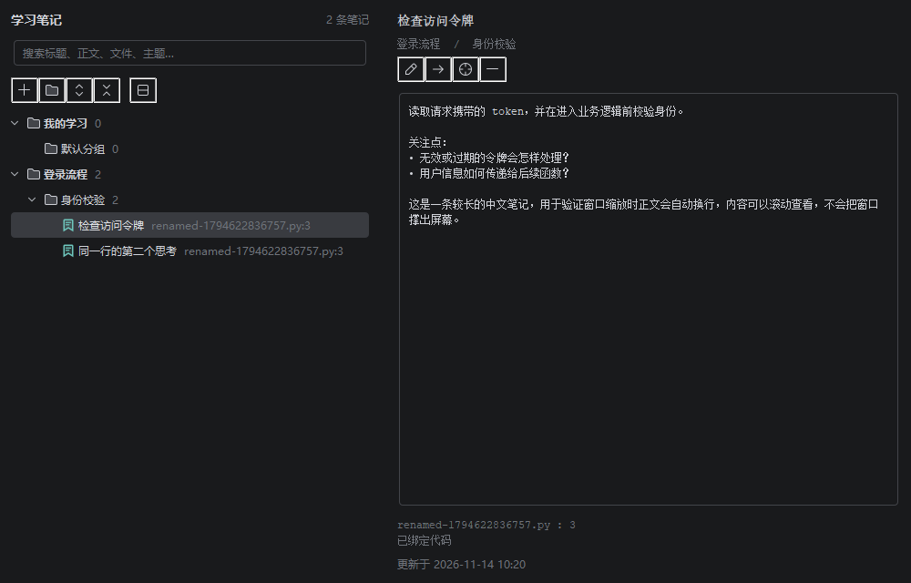

# Reading Notes

English · [简体中文](README.zh-CN.md)

Add notes to code lines and organize your understanding by **topic → group → note**. Click the bookmark icon beside a line number to view or edit its notes, without changing your source files.

Reading Notes is an independent, MIT-licensed plugin by **siseeker**, targeting **PyCharm 2025.3–2026.3 / IntelliJ Platform 253–263**. The interface supports Simplified Chinese and English. See [validation records](docs/VALIDATION.md) for the exact builds checked.

## Features

- Notes on any local text-file line, including blank lines.
- A clickable gutter icon; multiple notes on the same line share a chooser.
- Learning topics and groups, with rename, folding and empty-group support.
- Search titles, note bodies, file paths, topic names and group names.
- Double-click a note to navigate to its code.
- Resizable note dialogs with remembered dimensions.
- Adjustable tree/detail split, with vertical and horizontal layouts.
- Automatic text wrapping and IDE light/dark colors.
- Switch between Simplified Chinese and English without restarting the IDE.
- Anchors that follow edits and IDE file moves/renames. Ambiguous or deleted locations can be explicitly rebound.
- Local project storage; no plugin telemetry, cloud service or network dependency.

## Install

1. Download the latest published `ReadingNotes-<version>.zip` from [GitHub Releases](https://github.com/Sisyphus-seeker/reading-notes/releases) or install from [JetBrains Marketplace](https://plugins.jetbrains.com/plugin/36128-reading-notes).
2. Open **Settings → Plugins → gear menu → Install Plugin from Disk**.
3. Select the ZIP without extracting it, and follow the IDE's restart prompt if shown.
4. Open **View → Tool Windows → Reading Notes**.

GitHub distribution and JetBrains Marketplace publication are separate. A Marketplace listing is not required for installation from disk.

The public plugin ID is `io.github.sisyphusseeker.readingnotes`. Early local test builds used `dev.readingnotes.pycharm`; uninstall that test build before installing this one to avoid duplicate tool windows. Uninstalling preserves `.idea/reading-notes.xml`.

## Quick start

Use **中文 / EN** at the top of the notes panel and choose **English** or **简体中文**. Chinese is the initial default. The choice applies to open notes panels and newly opened dialogs, and is remembered across projects and IDE restarts. Existing note text, source code, topic/group names and bindings are preserved. New default topic/group names use the selected language. This setting changes Reading Notes; standard IDE and operating-system controls follow their own language settings.

1. Place the caret on a code line and press **Ctrl+Alt+Shift+N**, or choose **New Line Note / 新建行笔记** in the editor context menu.
2. Choose a topic and group, enter a title and note, then save. **Ctrl+Enter** saves from the body; Enter inserts a newline.
3. Click the teal gutter bookmark to reopen a note. If the line has multiple notes, choose one from the list.
4. Double-click a note in the tool window to jump to code. Press Enter on a selected note to edit it.
5. Use the split-layout toolbar button to switch between stacked and side-by-side views. Drag the divider to change the proportions.

To use a separate, resizable window, select **Float** or **Window** in the tool window header menu. The edit dialog itself is also resizable.

Shortcuts can be changed under **Settings → Keymap → New Line Note / 新建行笔记**. Editing the topic/group fields moves a note to that destination. Deleting a topic or group removes its notes after confirmation; there is no recycle bin in this version.

## Preview

These are renders of the actual plugin components in an isolated IDE with synthetic notes.





[Narrow sidebar preview](docs/previews/sidebar-narrow.png) · [Validation details](docs/VALIDATION.md)

## Sharing notes

Version 0.2.0 exports all notes or a selected topic, group or note to a portable JSON file. Imports preview path mappings, relocated code and conflicts before merging. Uncertain locations remain detached; local XML backups are created before import. See [sharing and recovery instructions](docs/SHARING.md).

## Storage and anchor behavior

Notes are stored in **`.idea/reading-notes.xml`** in each project. Paths inside the project are relative; external files use absolute file URLs. Back up this XML after saving the project. For a manual restore, close the project before replacing it.

The UI language preference is stored separately in the IDE configuration's `options/reading-notes-settings.xml`. It is excluded from project notebooks and sharing files.

The plugin uses editor range markers for open files, file pointers for IDE renames/moves, and saved source context when reopening or navigating to a closed file. Deleted or ambiguous locations are marked as needing confirmation; use **绑定到当前行** to bind a note to the caret's current line.

Large source rewrites, renames outside the IDE, and branch changes can require manual rebinding. Existing notes from other plugins are not imported. `.idea` is often ignored by Git; sharing the notes file and resolving its conflicts is an explicit project choice.

See [Privacy](docs/PRIVACY.md) for the data stored by the plugin.

## Build from source

The supplied build uses the **JBR 21 compiler bundled with a local PyCharm 2025.3 installation** on Windows. It does not download Gradle or IDE dependencies.

```powershell
powershell -NoProfile -ExecutionPolicy Bypass -File .\build.ps1 -IdeHome 'C:\Path\To\PyCharm'
```

Alternatively, set `PYCHARM_HOME`. The build runs the model tests and writes `dist/ReadingNotes-0.3.0.zip`. Continue compiling against Platform 253 / Java 21 to preserve support for 2025.3; testing a newer IDE does not require raising this compilation baseline. Build outputs, local IDE state and downloaded verification tools are ignored by Git.

The current build and sandbox scripts are Windows-specific. The plugin uses platform APIs, but macOS/Linux runtime behavior has not been validated.

## Tests and development IDE

Run the dependency-free Java model checks with JDK 21:

```powershell
powershell -NoProfile -ExecutionPolicy Bypass -File .\test-model.ps1
```

Launch a development IDE with separate config, system, plugins and sample-project directories:

```powershell
powershell -NoProfile -ExecutionPolicy Bypass -File .\run-sandbox.ps1 -IdeHome 'C:\Path\To\PyCharm'
```

For the IDE integration checks, use `-SmokeTest`, wait for that instance to exit, then run again with `-CheckRestart`. Results are written to `build/sandboxes/PY-<build>/results`. Each IDE build has separate config, caches, plugins and sample notes. The smoke test resets only its dedicated sample notebook. Test activities are excluded from the distributed plugin.

To run a newer IDE, pass its directory with `-IdeHome` and the 2025.3 compilation SDK with `-BuildIdeHome`. Use `-PluginZip` to test an existing release package without rebuilding it. Your everyday IDE and notes are not used by the sandbox.

For standalone binary compatibility checks and the combined binary/runtime/restart workflow, see [the verification instructions](docs/VERIFYING.md). The declared range is `253` through `263.*`; checking selected builds does not establish compatibility with every patch or IDE product in that range.

## Contributing

Issues and pull requests are welcome. See [CONTRIBUTING.md](CONTRIBUTING.md) for the project structure and validation steps.

## License and contact

[MIT License](LICENSE) · Copyright © 2026 **siseeker**.

- Source: https://github.com/Sisyphus-seeker/reading-notes
- Issues: https://github.com/Sisyphus-seeker/reading-notes/issues
- Contact: **olivia0v0666@gmail.com**
